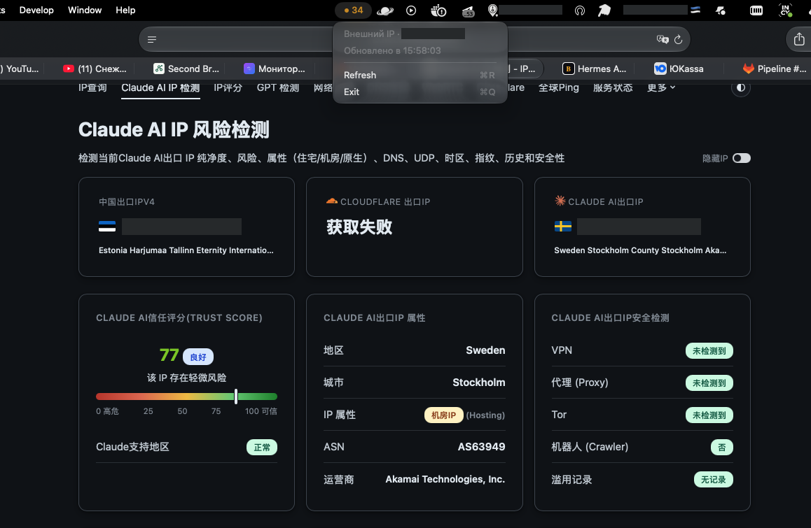

# ClaudeMeter

[English](#english)

ClaudeMeter показывает в строке меню macOS индекс Trust Score с [Net.Coffee](https://ip.net.coffee/claude/). Шкала идёт от красного (0) через жёлтый до зелёного (100). Нажмите на индекс, чтобы увидеть **IP Claude**, **Внешний IP**, время последней проверки и команды **Refresh** и **Exit**.



*Скриншот предыдущей сборки. Screenshot of an earlier build.*

Проверка выполняется при запуске, каждую минуту и сразу после уведомления macOS об изменении сетевого маршрута. Если смена публичного IP произошла на стороне провайдера, приложение обнаружит её при следующем опросе.

Приложение определяет **IP Claude** по соединению с `claude.ai` и запрашивает для него оценку через то же API, что и виджет Trust Score. **Внешний IP** определяется по соединению с `ip.net.coffee` и отображается справочно. При раздельной маршрутизации эти адреса могут различаться. Прочерк в строке меню означает, что индекс пока недоступен.

## Сборка и запуск

Требуется macOS 13 или новее. Для сборки нужны Xcode с Swift 6 или соответствующие Command Line Tools.

```sh
./scripts/build-app.sh
open dist/ClaudeMeter.app
```

Скрипт собирает приложение для Apple Silicon и Intel.

## English

ClaudeMeter displays the [Net.Coffee Trust Score](https://ip.net.coffee/claude/) in the macOS menu bar. The score runs from red (0) through yellow to green (100). Click the score to see the **Claude IP**, **Public IP**, and last check time, or to choose **Refresh** or **Exit**.

ClaudeMeter checks on launch, every minute, and whenever macOS reports a network route change. Public IP changes at the ISP are picked up on the next poll.

The app detects the **Claude IP** by connecting to `claude.ai` and requests its score from the same API as the Trust Score widget. The **Public IP** is the address seen by `ip.net.coffee`. These addresses can differ when traffic follows different routes. A dash in the menu bar means the score is unavailable.

### Build and run

Requires macOS 13 or later. To build, use Xcode with Swift 6 or the corresponding Command Line Tools.

```sh
./scripts/build-app.sh
open dist/ClaudeMeter.app
```

The script builds a universal app for Apple Silicon and Intel Macs.
